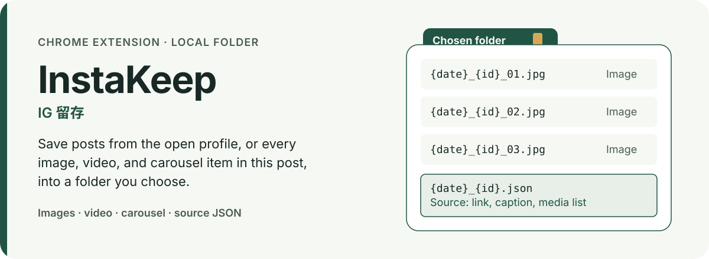
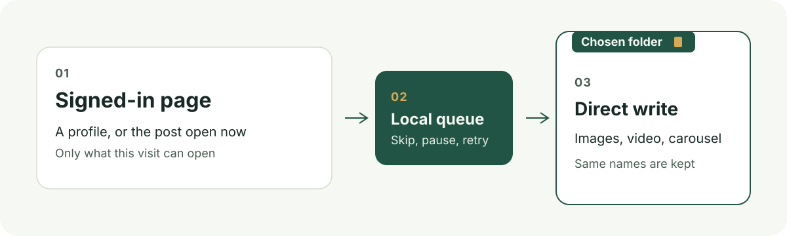

[中文](README.zh-CN.md)



# InstaKeep

A Chrome extension preview. It uses the Instagram session already open in the browser and writes profile posts, or the current post, into a folder you choose. It does not send media through a third-party downloader.

## What it does

- Save the posts on the open profile: images, video, and every carousel item.
- The post action labeled “InstaKeep · 下载全部图片” saves every image in that post and shows progress, success, or the failure reason beside the post.
- Video inside a mixed carousel is saved from the popup action “下载当前帖子的全部内容”.
- A source JSON file is on by default: post URL, account, publish time when Instagram provides it, caption, and the media list. You can turn it off.
- The default filename is `{date}_{id}_{index}`: date, content id, and carousel index. Files land in the chosen folder itself. A subfolder is created only when you set one. An existing file with the same name is kept.

## Verified results

`npm test` currently passes 44 tests, with 0 failures and 0 skipped.

Separate browser scripts cover the folder handle, a write that is confirmed only after the file is closed, keeping same-name files, a queue that survives a browser restart, pause and resume, and a post button that appears only on a post. The scripts are `scripts/destination-check.mjs`, `scripts/browser-check.mjs`, and `scripts/post-download-check.mjs`.

In real Chrome, opening a post from a profile and using the page button wrote that post’s images and source JSON into the chosen folder without opening the settings popup. A full profile backup, and whether a real video plays with audio, are not verified yet. The record is in [docs/validation.md](docs/validation.md) (Chinese).

## How it works



Leave Chrome and the original Instagram page open while a job runs. You can pause, resume, and retry failed items. After a browser restart, the folder may need to be authorized again.

Before a profile backup, turn on the temporary observation at the bottom of the popup, refresh the signed-in profile, scroll down once, then read the observation. A single-post job starts from that post’s page.

## Getting started

```bash
git clone https://github.com/HuangChenning/instakeep.git
cd instakeep
npm test
```

1. Open `chrome://extensions`, turn on Developer mode, choose “Load unpacked”, and select this repository.
2. Open the extension and choose “选择保存目录”. The picker starts in the system downloads folder. After you authorize it, files are written into that folder and do not follow Chrome’s download settings.
3. To save one post, open the post and click the InstaKeep icon in the action row.
4. To save a profile, finish the observation above, then choose “批量下载主页帖子”.

Subfolder and filename templates are in the popup. Fields are account, date, type, content id, and carousel index.

## Limitations

- Posts only. Reels as a category, stories, and highlights are not enabled.
- A backup includes only what the signed-in account can open and Instagram still serves. Deleted, expired, or inaccessible posts are outside that promise.
- The extension does not collect passwords or offer its own login. Settings, jobs, and completion records stay on this computer.
- There is no analytics report, cloud sync, or extension server. Media addresses are used only to write files into the folder you authorized.
- One open profile at a time. This is a personal preview and it is not published on the Chrome Web Store.
