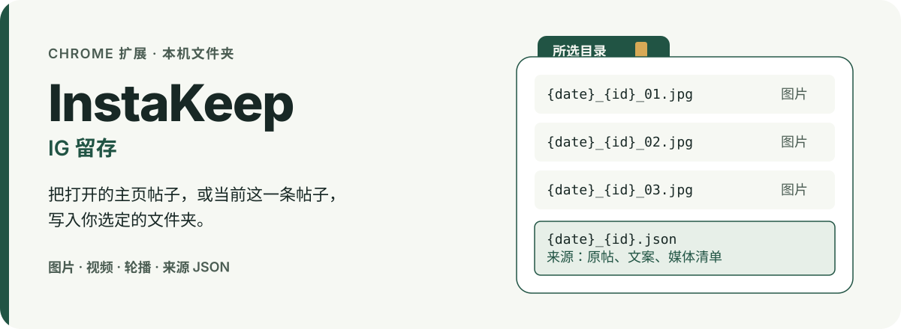
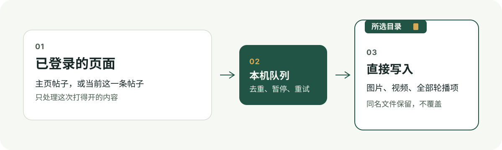

[English](README.md)



# InstaKeep · IG 留存

Chrome 扩展测试版。它使用浏览器里已经登录的 Instagram，把主页帖子或当前帖子的媒体写进你选的文件夹，不经过第三方下载站。

## 它能做什么

- 批量保存当前主页里的帖子：图片、视频和全部轮播项。
- 首页信息流和帖子详情页的操作栏上，「InstaKeep · 下载全部图片」会保存对应帖子的全部图片，并在帖子旁显示进度、完成或失败原因。
- 混合轮播里的视频，用弹窗中的「下载当前帖子的全部内容」。
- 默认文件名是 `{date}_{id}_{index}`，例如日期、内容 ID 和轮播序号。文件直接落在所选文件夹；只有你填写子文件夹时才额外建目录。同名文件保留，不覆盖。

## 验证效果

截至 2026-10-13，`npm test` 共 49 项通过，0 失败，0 跳过。

独立浏览器脚本覆盖了目录句柄、写入后确认成功、重名保留、队列在浏览器重启后仍在、暂停与恢复，以及首页信息流和详情页的按钮绑定对应帖子。脚本是 `scripts/destination-check.mjs`、`scripts/browser-check.mjs` 和 `scripts/post-download-check.mjs`。

在真实 Chrome 里，从主页打开一条帖子后，页面按钮已把该帖的多张图片写入所选目录，且没有打开设置弹窗。完整主页批量，以及真实视频能否播放、是否带声音，还没有验证。记录见 [docs/validation.md](docs/validation.md)。

## 保存流程



下载时请保持 Chrome 和原来的 Instagram 页面开着。可以暂停、恢复，以及重试失败项。浏览器重启后，文件夹可能需要重新授权。

批量备份前，在已登录的主页打开扩展下方的临时观察，刷新并向下滚动一次，再查看观察结果。单帖从原帖页面开始。

## 开始使用

```bash
git clone https://github.com/HuangChenning/instakeep.git
cd instakeep
```

1. 打开 `chrome://extensions`，开启开发者模式，选择「加载已解压的扩展程序」，选中本仓库目录。
2. 打开扩展，点击「选择保存目录」。选择器从系统下载文件夹开始。授权后，文件写入该文件夹本身，不使用 Chrome 的下载设置。
3. 保存单帖图片：在首页信息流或帖子详情页，点击分享按钮后的 InstaKeep 下载图标。
4. 批量保存：完成上面的临时观察后，点击「批量下载主页帖子」。

子文件夹和文件名模板在弹窗里，字段有账号、日期、类型、内容 ID、轮播序号。

## 当前限制

- 现在只做帖子。Reels 分类、快拍、精选没有启用。
- 只能保存当前账号看得到、并且 Instagram 仍提供的内容。已删除、已过期或无权查看的内容不在范围内。
- 不收集密码，也不提供扩展自己的登录。设置、任务和完成记录只留在本机。
- 没有统计上报、云同步或扩展自己的服务器。媒体地址只用于把文件写入你授权的文件夹。
- 一次处理当前打开的一个主页。个人使用的测试版，未上架 Chrome 网上应用店。

## 隐私与文档状态

来源 JSON 可包含帖子账号、原帖链接和文案；下载的媒体和 JSON 属于本地备份，不要随代码上传。报告问题时请移除账号、帖子标识、本机路径、Cookie、令牌和签名媒体地址。

当前功能与验证边界以本 README 和 [验收记录](docs/validation.md) 为准。[早期开发计划](docs/superpowers/plans/2026-10-12-instakeep.md)及[第一阶段验证记录](docs/feasibility.md)仅作历史参考，不代表当前功能或测试数量。
